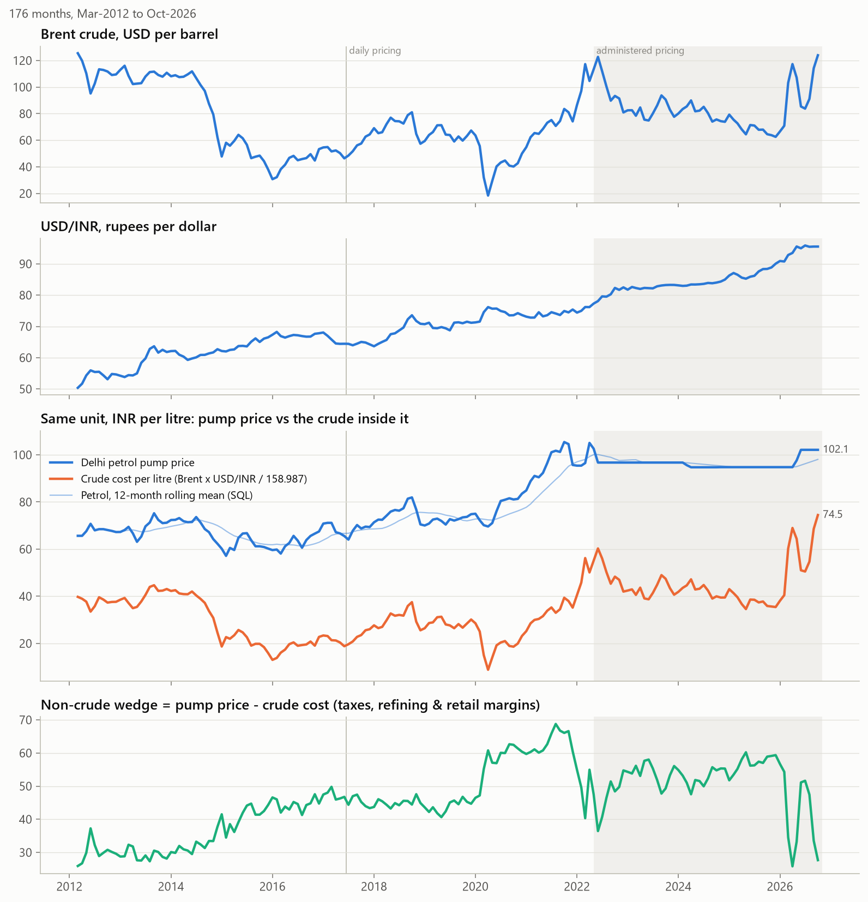
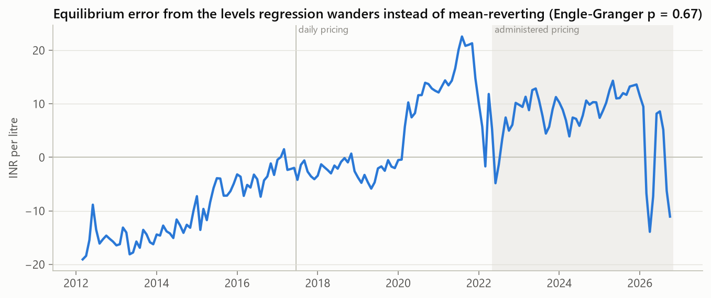
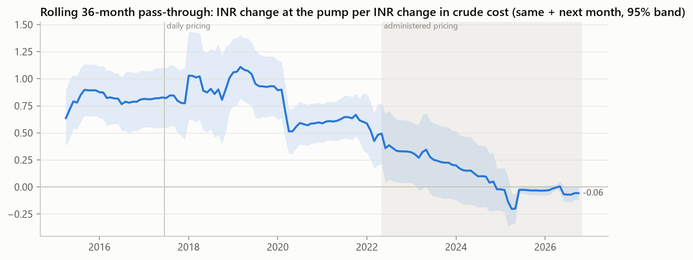
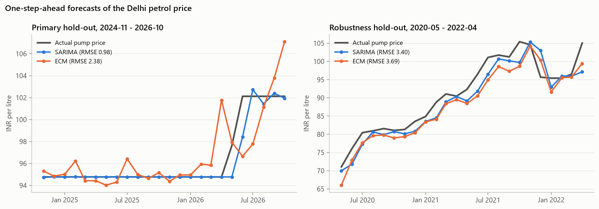

# Crude Oil → Retail Fuel Price Pass-Through (India)

**How much of a change in world crude prices reaches the petrol pump in Delhi, how fast, and can crude prices help forecast the pump price?**

176 months (Mar-2012 to Oct-2026) of Brent crude, USD/INR and the Delhi petrol price, scraped from official sources and modelled in MySQL. The analysis uses unit-root tests, Engle–Granger cointegration, an error-correction model (ECM) and a SARIMA benchmark on a 24-month hold-out.



---

## Key findings

| # | Finding | Evidence |
|---|---|---|
| 1 | All series are **I(1)** (non-stationary in levels, stationary in changes), so models are fitted on monthly **changes**, not raw levels. | ADF fails to reject a unit root in levels (p = 0.26–0.91) while KPSS rejects stationarity (p ≤ 0.013). On first differences ADF rejects (p < 0.0001) and KPSS does not (p ≥ 0.10). |
| 2 | **No stable long-run link** between the pump price and the rupee cost of crude. | Engle–Granger p = 0.67 (full window) and 0.76 (training window). The ECM's error-correction term is ≈ 0 (α = 0.004, p = 0.83). |
| 3 | While pricing was market-linked, **about ₹0.52 of every ₹1/litre move in crude cost reached the pump within 2 months**. Since May 2022 it is **zero**. | Pass-through 0.52 (s.e. 0.13, p < 0.001) for Mar-2012–Apr-2022, versus −0.01 (p = 0.87) for May-2022–Oct-2026. Rolling estimate in Fig. 3. |
| 4 | The crude-driven **ECM does not beat SARIMA** one step ahead. | Last 24 months: RMSE ₹2.38 (ECM) vs ₹0.98 (SARIMA). Last 24 market-linked months: ₹3.69 vs ₹3.40. |
| 5 | Crude **rises pass through more than falls** ("rockets and feathers": 0.78 vs 0.55), but the gap is **not statistically significant**. | Wald test p = 0.49, market-linked months. |

**Why the ECM loses.** About half the pump price is tax, and the government repeatedly changed central excise duty to absorb crude moves. It raised duty when crude fell (2014–16, 2020) and cut it when crude rose (2021–22, 2026). That keeps the bottom panel of the figure above (pump price minus crude cost) shifting in steps, so the two prices never settle into a fixed long-run relationship. Then, from May 2022, the retail price became administered: it moved on only a handful of policy dates. During the 24-month hold-out the monthly average moved in only 3 months (all price revisions fell in May 2026), while Brent swung between $62 and $124. A model that expects crude to feed through will predict moves that never happen. A no-change-style model such as SARIMA wins.

<sub>Sources for the excise history: PPAC's [current excise tariff table](https://ppac.gov.in/prices/central-excise-and-customs-rate-on-major-petroleum-products) (₹11.90/L on petrol as of 27-Mar-2026) and parliamentary answers on duty changes since 2014. These are context only; excise is not a model input (see Limitations).</sub>

---

## Data: scraped from the publishers

| Series | Source | What the scraper does |
|---|---|---|
| Brent crude, monthly average, USD/bbl | [U.S. EIA – Europe Brent Spot Price FOB](https://www.eia.gov/dnav/pet/hist/LeafHandler.ashx?n=PET&s=RBRTE&f=M) | Parses the year × month HTML table and reshapes it to one row per month. |
| USD/INR, daily | [Federal Reserve H.10 historical rates](https://www.federalreserve.gov/releases/h10/hist/dat00_in.htm) (the upstream source of FRED's DEXINUS) | Parses ~6,700 daily rows; holiday "ND" values are dropped. |
| Delhi petrol, Apr-2002 to Jun-2017 | [PPAC – RSP at Delhi up to 15.6.2017](https://ppac.gov.in/retail-selling-price-rsp-of-petrol-diesel-and-domestic-lpg/rsp-of-petrol-and-diesel-at-delhi-up-to-15-6-2017) | Parses the revision table. Dates come in mixed formats (`16.1.17`, `As on 01.04.15`, `21.06.06 (Reduction in VAT Rate)`) and fiscal-year header rows are mixed in. |
| Delhi petrol, daily since 16-Jun-2017 | [PPAC – RSP in metro cities since 16.6.2017](https://ppac.gov.in/retail-selling-price-rsp-of-petrol-diesel-and-domestic-lpg/rsp-of-petrol-and-diesel-in-metro-cities-since-16-6-2017) | The PDF is re-uploaded **under a new file name every day**, so the scraper finds the link on the page with BeautifulSoup, then extracts 3,438 daily rows from the 35-page PDF with a regex. |

All raw responses are archived in `data/raw/`, so every number can be traced to the page it came from. The scraper validates its output (plausible ranges, no duplicate days, no missing days) and stops if a site changes its layout.

---

## Pipeline

```
 scrape.py ──► data/raw/ (HTML, PDF) ──► data/interim/*.csv
                                              │
 build_database.py ─► MySQL ───────────────────┘
        01_schema.sql        staging tables at native frequency + calendar/month dimensions
        02_build_monthly.sql recursive-CTE calendar, day-weighted petrol price, FX average,
                             LEFT JOIN onto the month index + crude → INR/litre on the join
        03_features.sql      v_model_features: CTEs + LAG/AVG window functions
 quality_checks.py ─► 04_quality_checks.sql   (pipeline stops on any FAIL)
 stationarity.py      ADF + KPSS
 cointegration_ecm.py Engle–Granger, ECM, pass-through by regime, rolling pass-through, asymmetry
 forecast_eval.py     one-step-ahead ECM vs SARIMA vs no-change on the hold-out, Diebold–Mariano test
```

### SQL highlights

**Crude converted to rupees per litre on the join.** Each source is first brought to monthly frequency in its own CTE, then all three are LEFT JOINed onto the 176-month index, so a missing month shows up as NULL instead of silently disappearing:

```sql
SELECT m.month_start,
       b.brent_usd_bbl,
       ROUND(fx.usdinr, 4),
       ROUND(b.brent_usd_bbl * fx.usdinr / 158.987, 4) AS crude_inr_litre,  -- USD/bbl × INR/USD ÷ litres/bbl
       ROUND(p.petrol_rsp, 3)
FROM dim_month AS m
LEFT JOIN stg_brent_monthly AS b  ON b.month_start  = m.month_start
LEFT JOIN fx_m              AS fx ON fx.month_start = m.month_start
LEFT JOIN petrol_m          AS p  ON p.month_start  = m.month_start;
```

**A fair monthly petrol price.** Before mid-2017 prices changed roughly every fortnight; after that they changed daily. `LEAD()` turns each price record into a validity spell, a recursive CTE builds a daily calendar, and the monthly price is the **day-weighted** average: a price in force for 20 days counts 20 times.

**Lags, differences and rolling means with CTEs and `LAG` windows** (`sql/03_features.sql`). The view provides `d_petrol`, `d_crude`, their lags 1–3, crude rises and falls split apart, and 3- and 12-month rolling means. A rolling mean is emitted only once its window is full: `CASE WHEN month_index >= 12 THEN AVG(...) OVER (w ROWS BETWEEN 11 PRECEDING AND CURRENT ROW) END`. The models read these SQL columns directly.

**Gap checks on the monthly index** (`sql/04_quality_checks.sql`). Ten checks, all passing:
- **LAG gap test:** consecutive months must be exactly one month apart.
- **Gaps-and-islands:** `month_number − ROW_NUMBER()` must give a single unbroken run of 176 months.
- **Anti-join** of the month index against each source.
- **Coverage:** a pump price is known on every day of every month, and the daily PPAC feed skips no day.
- **Consistency:** the INR/litre conversion is recomputed and must match.
- **WARN-only:** large month-on-month moves are flagged for human review.

The SQL outputs were cross-checked against an independent pandas computation and agree to rounding (≤ ₹0.0005).

---

## Method and reasoning

1. **Unit roots (ADF + KPSS).** The two tests have opposite null hypotheses, so a series is called I(1) only when both agree, in levels (tested with constant + trend) and in differences.
   Results: [`reports/stationarity_tests.md`](reports/stationarity_tests.md)
2. **Engle–Granger cointegration.** Regress petrol on crude cost in levels, then test the residual for a unit root. The test uses **MacKinnon** critical values, not ordinary ADF values, which would be too lenient for an estimated residual. Three long-run specifications were tested, on the full and training windows: plain, with a trend, and Brent and USD/INR as separate regressors.
3. **ECM (Engle–Granger two-step), fitted on the training months only:**
   `Δpetrol_t = c + α·u_{t−1} + Σ φ_i Δpetrol_{t−i} + Σ θ_j Δcrude_{t−j} + ε_t`
   - Lag orders are picked by BIC; standard errors are autocorrelation-robust (HAC).
   - Only *lagged* terms enter, so every forecast uses information that existed a month earlier.
4. **SARIMA benchmark.**
   - d = 1 because the series is I(1).
   - Orders (p, q ≤ 2; seasonal P, Q ≤ 1) are picked by AIC on the training months.
   - No seasonal differencing, because AIC is not comparable across differencing orders.
5. **Evaluation.**
   - Parameters are frozen at the end of training, and each hold-out month is forecast from data up to the month before.
   - Models are compared on RMSE and MAE, plus a Diebold–Mariano test (with the small-sample correction) to see whether the gap is more than noise.

---

## Results

### Engle–Granger: no cointegration



The levels residual wanders from −₹19 to +₹22 instead of reverting to zero. Full details: [`reports/cointegration_ecm.md`](reports/cointegration_ecm.md).

### Pass-through by pricing regime

| Regime | Months | Pass-through (₹ per ₹1 of crude cost, months t to t−2) | p-value |
|---|---|---|---|
| Market-linked | Mar-2012 – Apr-2022 | **0.52** (s.e. 0.13) | < 0.001 |
| Administered | May-2022 – Oct-2026 | **−0.01** (s.e. 0.05) | 0.87 |



Each point is a 36-month window ending in that month. Pass-through ran at about 0.8–1.0 until 2019, fell to about 0.6 when the 2020 crude crash was absorbed by higher excise duty, and has been about 0 since 2025.

### Hold-out forecasts: ECM vs SARIMA (RMSE, ₹/litre)

| Hold-out | No-change | SARIMA | ECM | ECM vs SARIMA | Diebold–Mariano p |
|---|---|---|---|---|---|
| **Primary:** last 24 months (Nov-2024 – Oct-2026) | 1.09 | **0.98** | 2.38 | +143% | 0.07 |
| Robustness: last 24 market-linked months (May-2020 – Apr-2022) | 3.47 | **3.40** | 3.69 | +8% | 0.45 |



The robustness window was added *after* seeing the primary result. It asks whether the ECM does better while prices still followed crude. It narrows the gap but does not reverse it. In the primary window the ECM reacted to the Mar-2026 crude spike one month before the pump price actually moved (May–Jun 2026), then predicted rises in Sep–Oct 2026 that never came.

---

## How to run

Requires Python 3.10+ and MySQL 8.0+ (the SQL uses CTEs, window functions and CHECK constraints).

```powershell
python -m venv .venv
.\.venv\Scripts\activate
pip install -r requirements.txt

# No MySQL installed? This script fetches the official MySQL 8.4 no-install ZIP (~280 MB)
# into .mysql\ and starts it on 127.0.0.1:3307. No installer or admin rights needed.
powershell -ExecutionPolicy Bypass -File scripts\start_local_mysql.ps1
$env:MYSQL_PORT = "3307"

python run_pipeline.py             # scrape fresh data + full analysis (~40 s)
python run_pipeline.py --offline   # reuse the archived raw files in data/raw/
```

With your own MySQL, set `MYSQL_HOST`, `MYSQL_PORT`, `MYSQL_USER`, `MYSQL_PASSWORD` and `MYSQL_DB` (defaults are in `config.py`). The user needs rights to create the `fuel_passthrough` database. Each step can also be run alone, e.g. `python -m src.forecast_eval`.

## Project structure

```
config.py               study window (176 months), hold-out length, regime date, DB settings
run_pipeline.py         runs all six steps
sql/                    01_schema · 02_build_monthly · 03_features · 04_quality_checks
src/                    scrape · build_database · quality_checks · stationarity ·
                        cointegration_ecm · forecast_eval · models (shared) · db · plot_style
data/raw/               archived HTML/PDF responses
data/interim/           parsed CSVs loaded into MySQL
data/processed/         fuel_monthly + model_features exported from MySQL
reports/                markdown/CSV/JSON results and figures/
scripts/                start_local_mysql.ps1
```

## Limitations and next steps

- **Taxes are the missing variable.** A history of central excise duty and Delhi VAT would let the long-run equation be `pump price ≈ crude cost + taxes + margins`, which may well cointegrate. No official, machine-readable history was found: PPAC publishes only current rates, and past changes are scattered across press releases and parliamentary answers.
- **Brent is a proxy.** India buys the Indian crude basket, and retail prices are actually benchmarked to international *petrol* prices. Both track Brent closely, but not exactly.
- **Crude cost is a monthly-average approximation.** The product of the monthly average Brent price and the monthly average rate is used in place of the average of daily products.
- **Next steps:**
  - A regime-switching or threshold ECM, which could model "administered" vs "market-linked" months explicitly.
  - Gregory–Hansen tests, which allow a structural break in the cointegrating relation.
